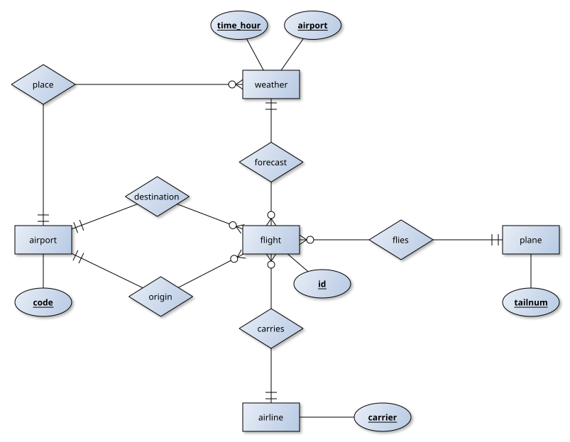
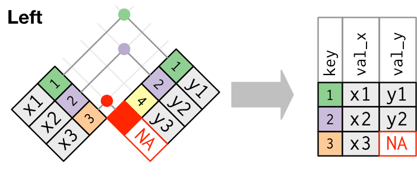
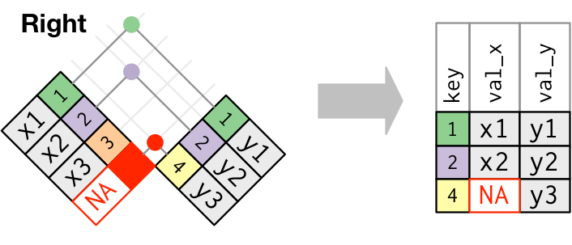
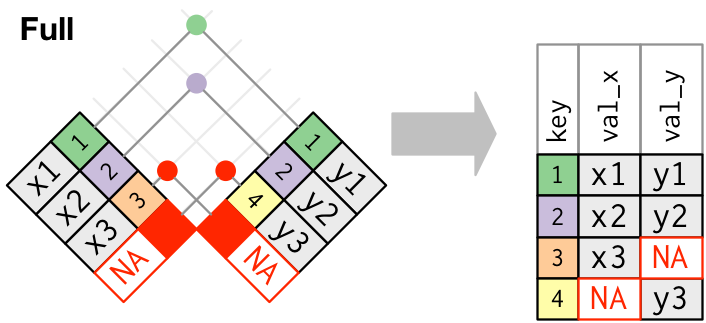
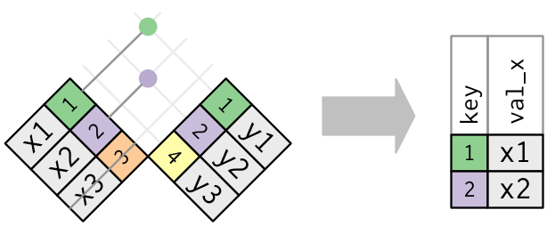
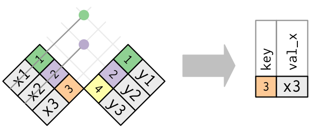

```{r setup, include=FALSE}
knitr::opts_chunk$set(cache = TRUE, message = FALSE, warning = FALSE)
```

## Overview - Unary verbs

[dplyr](https://dplyr.tidyverse.org) is a **grammar of data
manipulation**, providing a consistent set of verbs that help you solve
the most common data manipulation challenges:

- `select()` picks variables based on their names (it's a filter on
  columns of the data frame)
- `filter()` picks cases based on their values (it's a filter on rows of
  the data frame)
- `mutate()` adds new variables that are typically functions of existing
  variables
- `arrange()` changes the ordering of the rows
- `group_by()` partitions rows of data into groups defined by the values
  of some variables
- `summarise()` reduces multiple values down to a single summary,
  typically used in combination with `group_by()`

## Overview - Binary verbs

In practice, you’ll normally have many tables that contribute to an
analysis, and you need flexible tools to combine them.

In dplyr, there are three families of verbs that work with two tables at
a time:

- **mutating joins**, which add new variables to one table from matching
  rows in another
- **filtering joins**, which filter observations from one table based on
  whether or not they match an observation in the other table
- **set operations**, which combine the observations in the data sets as
  if they were set elements

## New York flights dataset

The
[nycflights13](https://cran.r-project.org/web/packages/nycflights13/index.html)
dataset contains information about all flights that departed from New
York City in 2013 and related metadata (planes, airports, airlines and
weather conditions).

Type the name of the table in the help to read about the meaning of the
columns.

Here is an Entity-Relationship schema for the dataset:

```{r}
library("nycflights13")
```

::: {style="text-align:center"}

:::

## The Star Wars dataset

> All the Star Wars data you've ever wanted: Planets, Spaceships,
> Vehicles, People, Films and Species. From all SEVEN Star Wars films

The Star Wars API, or [SWAPI](https://swapi.dev/), is the world's first
quantified and programmatically-accessible data source for all the data
from the Star Wars canon universe!

A fraction of the data source is contained in the dataset starwars in
the dplyr package:

```{r}
library("dplyr")
```

## Pipes

Pipes are a powerful tool for clearly expressing a sequence of multiple
operations.

> Little bunny Foo Foo\
> Went hopping through the forest\
> Scooping up the field mice\
> And bopping them on the head

### Intermediate steps

```{r eval=FALSE}
foo_foo_1 <- hop(foo_foo, through = forest)
foo_foo_2 <- scoop(foo_foo_1, up = field_mice)
foo_foo_3 <- bop(foo_foo_2, on = head)
```

Too many unimportant names!

### Overwrite the original

```{r eval=FALSE}
foo_foo <- hop(foo_foo, through = forest)
foo_foo <- scoop(foo_foo, up = field_mice)
foo_foo <- bop(foo_foo, on = head)
```

Debugging is painful!

### Function composition

```{r eval = FALSE}
bop(
  scoop(
    hop(foo_foo, through = forest),
    up = field_mice
  ), 
  on = head
)
```

Hard for a human to consume!

### Use the pipe

``` {reval="FALSE"}
foo_foo |>
  hop(through = forest) |>
  scoop(up = field_mouse) |>
  bop(on = head)
```

This is our favorite form, because it focuses on verbs, not nouns!

Notice that the **native pipe** `|>` was introduced in R 4.1.0. It
requires no package. Whereas `%>%` requires `magrittr` or, more
commonly, a package such as `dplyr` or `tidyverse` that makes it
available.

```{r}
1:10 |> 
  mean()
```

As a general rule:

> Use `|>` for new code; know how to read `%>%` in existing code.

# Unary verbs

## filter

Verb `filter()` picks cases based on their values (it's a filter on rows
of the data frame).

```{r}
starwars |>  
  filter(species == "Droid")
```

```{r}
starwars |> 
  filter(species == "Droid" & eye_color == "red")
# or
starwars |> 
  filter(species == "Droid", eye_color == "red")

```

```{r}
starwars |> 
  filter(species == "Droid" | species == "Wookiee")
```

```{r}
starwars |> 
  filter(species == "Droid", !is.na(birth_year))
```

## select

Verb `select()` picks variables based on their names (it's a filter on
columns of the data frame).

```{r}
starwars |> 
  select(name, gender, birth_year)
```

```{r}
starwars |> 
  select(name, ends_with("color"))
```

```{r}
starwars |> 
  select(-films, -vehicles, -starships)
```

```{r}
starwars |> 
  select(-contains("color"))
```

## Play

> The name of all characters with blue eyes and blond hair

## Solution

```{r}
starwars |> 
  filter(hair_color == "blond", eye_color == "blue") |> 
  select(name)

```

## Play

> The film starred by Luke Skywalker

## Solution

```{r}
starwars |> 
  filter(name == "Luke Skywalker") |> 
  select(films)

```

```{r}
starwars |> 
  filter(name == "Luke Skywalker") |> 
  pull(films) |> 
  unlist()

starwars |> 
  select(name)

starwars |> 
  pull(name)
```

## Play

> 1.  flights on Christmas
> 2.  flights that have a valid delay either on departure or on arrival
> 3.  flights that have a valid delay on departure but not on arrival

#MySolutions #1 flights \|\> filter(month == 12, day == 25)

#2 flights \|\> filter(!is.na(dep_delay) \| !is.na(arr_delay))

#3 flights \|\> filter(!is.na(dep_delay) & is.na(arr_delay))

## Solution

```{r}

# flights on Christmas
filter(flights, month == 12 & day == 25)

# flights that have a valid delay 
# either on departure or on arrival
filter(flights, !is.na(dep_delay) | !is.na(arr_delay))

# flights that have a valid delay on departure and not on arrival
filter(flights, !is.na(dep_delay) & is.na(arr_delay))
```

## mutate

Verb `mutate()` adds new variables that are typically functions of
existing variables.

```{r}
starwars |> 
  mutate(bmi = mass / ((height / 100)  ^ 2)) |>
  filter(bmi >= 18.5, bmi <= 24.9) |> 
  select(name:mass, bmi)
```

## Play

If a table lacks a natural primary key (a set of attributes that
identify observations), it's sometimes useful to add one that simply
contains the row number. This is called a **surrogate key**.

This is the case of flights table. Add an unique attribute id to the
flights table.

#Copio e aggiungo alla copia

#MySolution 
flights2 = data.frame(flights) 
flights2 = flights2 |> mutate(id = 1:nrow(flights2)) |> select(id, everything())
View(flights2)

## Solution

```{r}
flights = 
  flights |> 
  mutate(id = 1:nrow(flights)) |>
  select(id, everything())

flights
```

## Play

Add a catchup variable that contains the catch up time of the flight
defined as the departure delay minus the arrival delay; then select id
and delays of flights that catched up during the flight

#MySolution 
flights3 = data.frame(flights) 
flights3 = flights3 |>mutate(catchup = (dep_delay-arr_delay)) |> select(id, dep_delay, arr_delay, catchup) |> filter(catchup > 0) 
View(flights3)

## Solution

```{r}
# flights that catched up during the flight sorted by catch up time
flights |> 
  mutate(catchup = dep_delay - arr_delay) |>
  select(id, dep_delay, arr_delay, catchup) |>
  filter(catchup > 0)
```

## arrange

Verb `arrange()` changes the ordering of the rows.

```{r}
starwars |> 
  arrange(mass) |> 
  select(name, mass, height)
```

```{r}
starwars |> 
  arrange(desc(mass)) |> 
  select(name, mass, height)
```

```{r}
starwars |> 
  arrange(-mass, -height) |> 
  select(name, mass, height)
```

## Play

> The name and birth year of all human characters living in Tatooine
> sorted by birth year

## Solution

```{r}
starwars |> 
  filter(species == "Human" & homeworld == "Tatooine") |> 
  select(name, birth_year) |> 
  arrange(birth_year)

```

## Play

> The characters sorted in decreasing order of popularity (the
> popularity is the number of films starred by a characted)

Hint: use `sapply` function.

## Solution

```{r}
starwars |> 
  mutate(popularity = sapply(films, length)) |> 
  arrange(desc(popularity)) |> 
  select(name, popularity)

# why not like that?
starwars |> 
  mutate(popularity = length(films)) |> 
  arrange(desc(popularity)) |> 
  select(name, popularity)


```

## group by and summarise

- verb `group_by()` partitions rows of data into groups defined by the
  values of some variables\
- verb `summarise()` reduces multiple values down to a single summary
- they are typically used in combination.

## group by and summarise

```{r}
starwars |>
  group_by(species) |>
  summarise(count = n()) |> 
  arrange(-count)
```

```{r}
starwars |>
  count(species, sort = TRUE)
```

```{r}
# group species by cardinality and compute average mass. Notice some averages are NA, why?
starwars |>
  group_by(species) |>
  summarise(
    n = n(),
    mass = mean(mass))


# average on valid values only. Notice the NaN value for Chagrian species. Why?
starwars |>
  group_by(species) |>
  summarise(
    n = n(),
    mass = mean(mass, na.rm = TRUE))

# filter valid observations
starwars |>
  group_by(species) |>
  summarise(
    n = n(),
    mass = mean(mass, na.rm = TRUE)) |>
  filter(!is.nan(mass)) |> 
  arrange(desc(mass))


```

## Play

> The number of characters with a given eye and hair color sorted in
> decreasing order

## Solution

```{r}
count(starwars, hair_color, eye_color, sort=TRUE)

starwars |> 
  group_by(hair_color, eye_color) |> 
  summarise(n = n()) |> 
  arrange(-n)
```

## Play

> 1.  the number of flights per day
> 2.  the busy days (with more than 1000 flights)

## Solution

```{r}
# the number of flights per day
flights |> 
  group_by(month, day) |>
  summarise(count = n())
# or
count(flights, month, day)
```

```{r}
# the busy days (with more than 1000 flights)
count(flights, month, day) |>
  filter(n > 1000)
```

## Play

> The mean departure delay per day sorted in decreasing order of all
> flights on busy days of July

## Solution

```{r}
# the mean departure delay per day sorted in 
# decreasing order of all flights on busy days of July 
flights |> 
  filter(month == 7) |>
  group_by(day) |>
  summarise(n = n(), avg_delay = mean(dep_delay, na.rm = TRUE)) |>
  filter(n > 1000) |>
  arrange(desc(avg_delay))
```

# Binary verbs

## Overview

- It’s rare that a data analysis involves only a single table of data
- In practice, you’ll normally have many tables that contribute to an
  analysis, and you need flexible tools to combine them
- All two-table verbs work similarly: the first two arguments are tables
  to combine and the output is always a new table

## Set operations

These expect the input tables x and y to have the same variables, and
treat the observations like sets, hence the resulting table have unique
observations:

- `intersect(x, y)`: return observations in both x and y
- `union(x, y)`: return observations in either x or y
- `setdiff(x, y)`: return observations in x, but not in y

## Set operations

```{r}
df1 = tibble(x = c(1, 2), y = c("a", "a"))
df2 = tibble(x = c(1, 1), y = c("a", "b"))

df1
df2

intersect(df1, df2)

union(df1, df2)

setdiff(df1, df2)

setdiff(df2, df1)
```

## Joins

- **mutating joins** add new variables to one table from matching rows
  in another
  - **inner join** includes observations that match in both tables
  - **outer join** (left, right, full) includes also observations that
    do not match in one of the tables
- **filtering joins** filter observations from one table from matching
  rows in another
  - **semi-join** filter observations from one table based on whether
    they match an observation in the other table
  - **anti-join** filter observations from one table based on whether
    they do not match an observation in the other table

## Inner join

**Inner join** only includes observations that match in both tables.

::: {style="text-align:center"}

:::

## Inner join

```{r}
x <- tribble(
  ~key, ~val_x,
     1, "x1",
     2, "x2",
     3, "x3"
)
y <- tribble(
  ~key, ~val_y,
     1, "y1",
     2, "y2",
     4, "y3"
)

inner_join(x, y)
```

## Left join

**Left join** includes observations that match in both tables (like
inner join) plus the observations of the left table that find no match
in the right table.

::: {style="text-align:center"}

:::

## Left join

```{r}
x <- tribble(
  ~key, ~val_x,
     1, "x1",
     2, "x2",
     3, "x3"
)
y <- tribble(
  ~key, ~val_y,
     1, "y1",
     2, "y2",
     4, "y3"
)

left_join(x, y)
```

## Right join

**Right join** includes observations that match in both tables (like
inner join) plus the observations of the right table that find no match
in the left table.

::: {style="text-align:center"}

:::

## Right join

```{r}
x <- tribble(
  ~key, ~val_x,
     1, "x1",
     2, "x2",
     3, "x3"
)
y <- tribble(
  ~key, ~val_y,
     1, "y1",
     2, "y2",
     4, "y3"
)

right_join(x, y)
```

## Full join

**Full join** includes observations that match in both tables (like
inner join) plus the observations of the left table that find no match
in the right table and those in the right table that find no match in
the left table.

::: {style="text-align:center"}

:::

## Full join

```{r}
x <- tribble(
  ~key, ~val_x,
     1, "x1",
     2, "x2",
     3, "x3"
)
y <- tribble(
  ~key, ~val_y,
     1, "y1",
     2, "y2",
     4, "y3"
)

full_join(x, y)
```

## Semi-join

Semi-join keeps all observations in the first table that have a match in
the second table.

::: {style="text-align:center"}

:::

## Semi-join

```{r}
x <- tribble(
  ~key, ~val_x,
     1, "x1",
     2, "x2",
     3, "x3"
)
y <- tribble(
  ~key, ~val_y,
     1, "y1",
     2, "y2",
     4, "y3"
)

semi_join(x, y)
```

## Anti-join

Anti-join keeps all observations in the first table that have **no
match** in the second table.

::: {style="text-align:center"}

:::

## Anti-join

```{r}
x <- tribble(
  ~key, ~val_x,
     1, "x1",
     2, "x2",
     3, "x3"
)
y <- tribble(
  ~key, ~val_y,
     1, "y1",
     2, "y2",
     4, "y3"
)

anti_join(x, y)
```

## Joining NYC flights

A **natural join** is a join on common attributes of tables.

```{r}
# Drop unimportant variables so it's easier 
# to understand the join results
flights2 = flights |> 
  select(year:day, hour, origin, dest, tailnum, carrier)

flights2
airlines

flights2 |> 
  left_join(airlines)

left_join(flights2, airlines)

```

## Joining NYC flights

Both tables flights and planes have year columns, but they mean
different things, so we don't want to join them.

```{r}
flights2
planes

flights2 |> 
  left_join(planes, join_by(tailnum))
```

Note that the year columns in the output are disambiguated with a
suffix.

## Joining NYC flights

Each flight has an origin and destination airport, so we need to specify
which one we want to join to:

```{r}
flights2
airports
```

```{r}
flights2 |> 
  left_join(airports, join_by(dest == faa))

flights2 |> 
  left_join(airports, join_by(origin == faa))

```

## Joining NYC flights

Use **semi-join** to filter observations of the first table that match
in the second table. For instance:

> Which are the flights to the top-10 popular destinations?

```{r}
top_dest = flights |>
  count(dest, sort = TRUE) |>
  head(10) # select first 10 rows

top_dest

semi_join(flights2, top_dest)
```

## Joining NYC flights

Use **anti-join** to check foreign key integrity.

For example, the attribute tailnum in flights table refers to (is a
foreign key of) the same attribute in table planes.

The foreign key constraint claims that:

> Each valid foreign key value (tailnum in flights) must correspond to a
> value in the referenced table (tailnum in planes).

```{r}
flights |> 
  anti_join(planes, join_by(tailnum)) |> 
  count(tailnum, sort = TRUE)
```

Mind that in case foreign key integrity is violated, left join and inner
join produce different outputs:

```{r}
nrow(left_join(flights2, planes, join_by(tailnum)))
nrow(inner_join(flights2, planes, join_by(tailnum)))
```

## Play

> Flights that flew with a plane manufactured by BOEING

## Solution

```{r}
# flights that flew with a plane manufactured by BOEING
flights |> 
  inner_join(planes, join_by(tailnum)) |>
  select(id, tailnum, manufacturer) |>
  filter(manufacturer == "BOEING") 

# more efficient
flights |> 
  inner_join(filter(planes, manufacturer == "BOEING"), join_by(tailnum)) |>
  select(id, tailnum, manufacturer)

library(microbenchmark)

first = function(flights, planes) {
  flights |> 
  inner_join(planes, join_by(tailnum)) |>
  select(id, tailnum, manufacturer) |>
  filter(manufacturer == "BOEING") 
}

second = function(flights, planes) {
  flights |> 
  inner_join(filter(planes, manufacturer == "BOEING"), join_by(tailnum)) |>
  select(id, tailnum, manufacturer)
}

# times in ms
microbenchmark(first(flights, planes), 
               second(flights, planes), 
               times = 10)


```

## Play

> Flights that flew to a destination with an altitude greater than 6000
> feet sorted by altitude

## Solution

```{r}
# flights that flew to a destination with an altitude 
# greater than 6000 feet sorted by altitude
flights |> 
  inner_join(filter(airports, alt > 6000), join_by(dest == faa)) |>
  select(id, dest, name, alt) |>
  arrange(alt) 
```

## Play

> Flights that took off with a plane with 4 engines and a visibility
> lower than 3 miles


## Solution

```{r}
# flights that took off with a plane with 
# 4 engines and a visibility lower than 3 miles
flights |>
  inner_join(filter(weather, visib < 3), join_by(origin, time_hour)) |>
  inner_join(filter(planes, engines == 4), join_by(tailnum)) |>
  select(id, engines, visib) 

```

## Play

> Flights with destination and origin airports with an altitude
> difference of more than 6000 feet

## Solution

```{r}
# flights with destination and origin airports with 
# an altitude difference of more than 6000 feet
flights |> 
  inner_join(airports, join_by(origin == faa)) |>
  inner_join(airports, join_by(dest == faa)) |>
  select(id, alt.x, alt.y) |>
  mutate(altdelta = abs(alt.y - alt.x)) |>
  filter(altdelta > 6000) |> 
  arrange(id)


# Alternative: use cross-join (makes a cross product of two tables)
cross_join(select(airports, faa, alt), select(airports, faa, alt)) |> 
  mutate(altdelta = abs(alt.y - alt.x)) |>
  filter(altdelta > 6000) |>
  inner_join(select(flights, id, origin, dest), join_by(faa.x == origin, faa.y == dest))  |>
  select(id, alt.x, alt.y, altdelta) |> 
  arrange(id)

```

```{r}
# which is faster?
library(microbenchmark)

first = function(flights, airports) {
  flights |> 
  inner_join(airports, join_by(origin == faa)) |>
  inner_join(airports, join_by(dest == faa)) |>
  select(id, alt.x, alt.y) |>
  mutate(altdelta = abs(alt.y - alt.x)) |>
  filter(altdelta > 6000) |> 
  arrange(id)
}

second = function(flights, airports) {
  cross_join(select(airports, faa, alt), select(airports, faa, alt)) |> 
  mutate(altdelta = abs(alt.y - alt.x)) |>
  filter(altdelta > 6000) |>
  inner_join(select(flights, id, origin, dest), join_by(faa.x == origin, faa.y == dest))  |>
  select(id, alt.x, alt.y, altdelta) |> 
  arrange(id)
}

# times in ms
microbenchmark(first(flights, airports), 
               second(flights, airports), 
               times = 100)

```

## Play

Check that attribute tailnum is a key for table planes, that is it
identifies the table observations.

## Solution

```{r}
planes |> 
  count(tailnum) |> 
  filter(n > 1)
```

## Play

- check that the foreign key constraint from attribute dest of table
  flights to attribute faa of table airports does not hold
- set to NA the attribute dest of the rows of flights that do not match
  an airport
- do not remove the rows of flights that do not match an airport since
  they contain other useful information
- then check the foreign key constraint again

## Solution

```{r}
flights |>
  anti_join(airports, join_by(dest == faa)) |>
  count(dest, sort = TRUE)

id_set = 
  flights |> 
  anti_join(airports, join_by(dest == faa)) |> 
  pull(id)

flightsValid = 
  flights |> 
  mutate(dest = ifelse(id %in% id_set, NA, dest))

flightsValid |>
  anti_join(airports, join_by(dest == faa)) |>
  count(dest, sort = TRUE)

```

## Dig deeper

> - [data transformation with
>   dplyr](https://r4ds.hadley.nz/data-transform.html)
> - [joins with dplyr](https://r4ds.hadley.nz/joins.html)
