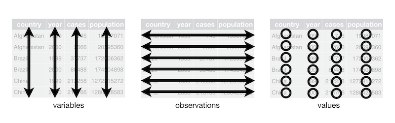
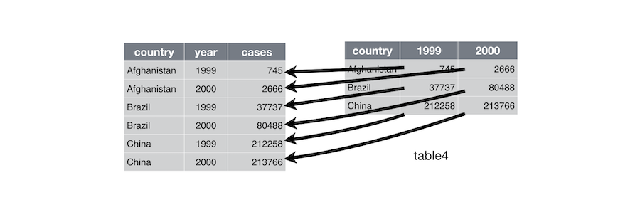
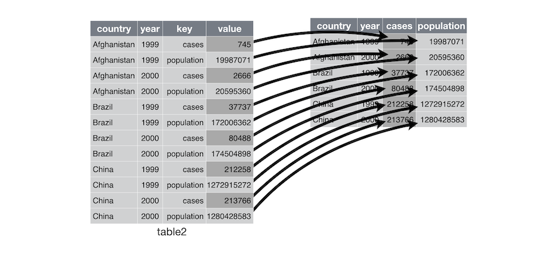
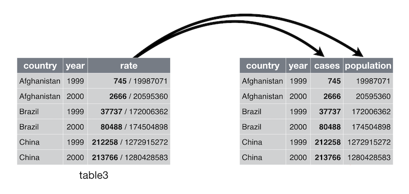
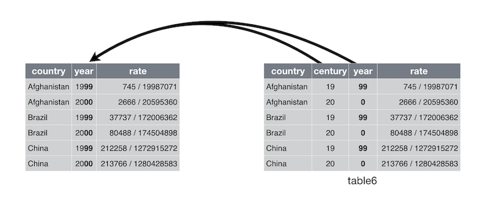

```{r setup, include=FALSE}
knitr::opts_chunk$set(cache = TRUE, message = FALSE, warning = FALSE)
```

## Tidy data

> "Happy families are all alike; every unhappy family is unhappy in its own way." --– Leo Tolstoy


## Tidy data

The data scientist manages variables, observations and values:

1. A **variable** is a quantity or quality that you can measure
1. A **value** is the state of a variable when you measure it
1. An **observation** is a set of measurements of variables made under similar conditions

## Tidy data

There are three interrelated rules which make a dataset **tidy**:

1. Put each variable in a column
1. Put each observation in a row
1. Put each value in a cell

<div style="text-align:center"></div>


## Tidy data

Why ensure that your data is tidy? There are two main advantages:

>1. the consistent structure lets you **focus on questions** about the data, not fighting to get the data into the right form to answer your questions
> 1. there's a specific advantage to placing variables in columns because most built-in R functions work with **vectors of values** 

However, there are lots of useful and well-founded data structures that are not tidy data. An important example is the **adjacency matrix** to represent a network.  

## Tidy and messy data

Each dataset below shows the same values of four variables *country*, *year*, *population*, and *cases*, but each dataset organises the values in a different way.

```{r}
library(tidyr)

table1
table2
table3
# Spread across two tibbles
table4a  # cases
table4b  # population
```


## Gathering 

> Apply gathering when variables are in fact values and a single row gathers many observations

<div style="text-align:center"></div>

> Gathering makes wide tables narrower and longer.

## Gathering 
This is the case of `table4a` and `table4b` above, that we can gather as follows:

```{r}
new_table4a = pivot_longer(table4a, c(`1999`, `2000`), 
                           names_to = "year", 
                           values_to = "cases")


new_table4b = pivot_longer(table4b, c(`1999`, `2000`), 
                           names_to = "year", 
                           values_to = "population")


```

Finally, we can join the gathered tables to obtain the original tidy data frame stored in `table1` above:

```{r message=FALSE, warning=FALSE}
library(dplyr)

left_join(new_table4a, new_table4b)
```


## Spreading
> Apply spreading when values are in fact variables and a single observation is spread across many rows.

<div style="text-align:center"></div>

> Spreading makes long tables shorter and wider.

## Spreading

This is the case of `table2` above, that we can spread as follows:

```{r}
table2
pivot_wider(table2, names_from = type, values_from = count)
```


## Separating 

> Apply separating when values are composite (not atomic): a column gathers many variables.

<div style="text-align:center"></div>

## Separating 

This is the case of `table3` above, that we can separate as follows: 

```{r}
table3
separate(table3, rate, into = c("cases", "population"), 
         sep = "/", convert = TRUE)
```

You can also pass a vector of integers to `sep`. `separate()` will interpret the integers as positions to split at:

```{r}
table5 = separate(table3, year, into = c("century", "year"), sep = 2)
table5
```


## Uniting

> Apply uniting when values are partial: a variable is spread across many columns.

<div style="text-align:center"></div>

## Uniting

This is the case of `table5` below, that we can unite as follows: 

```{r}
table5
unite(table5, new, century, year, sep = "")
```


## Dig deeper

>* [Data import with readr](https://r4ds.hadley.nz/data-import.html)
>* [Tidy data with tidyr](https://r4ds.hadley.nz/data-tidy.html)


    


